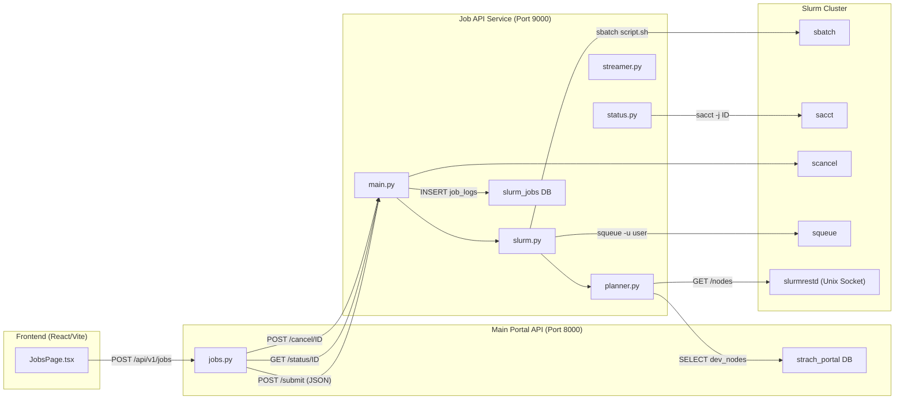
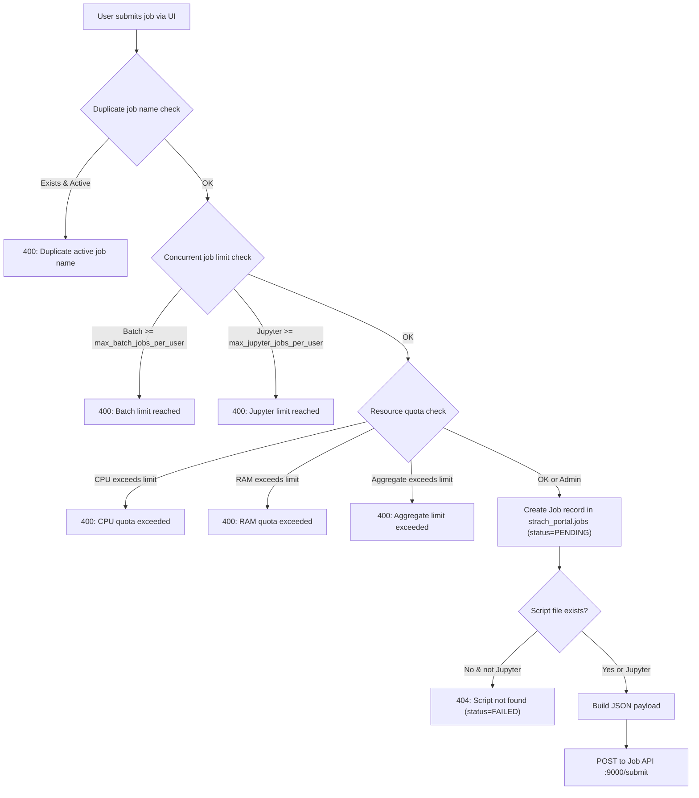
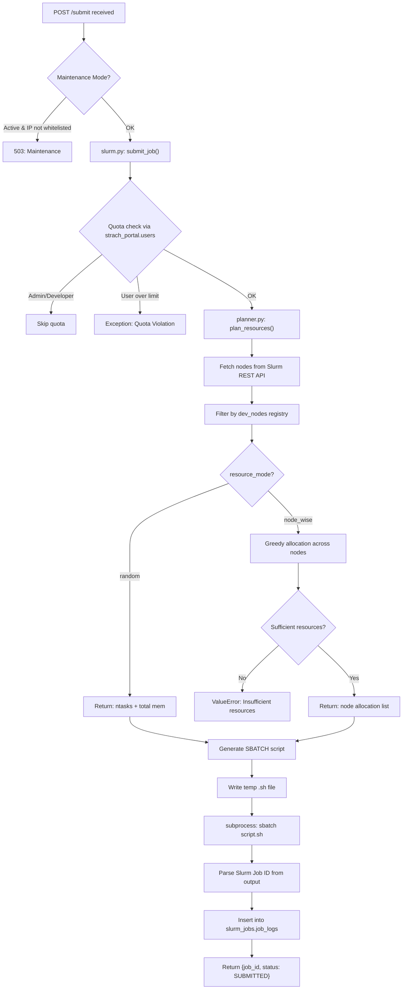
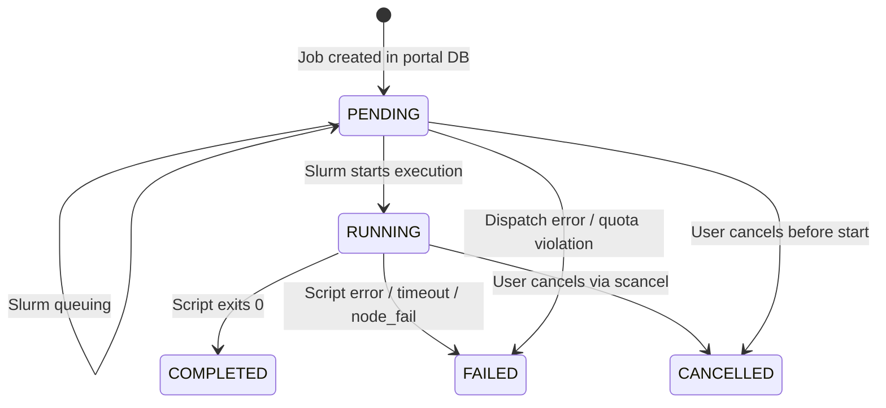

# HPC Portal — Job API & Resource Allocation Workflow

> Complete analysis of the current job submission, resource planning, and lifecycle management system.  
> **Date**: 2026-03-30 · **Scope**: `backend/job-api/` (Port 9000) + `backend/app/api/v1/jobs.py` (Port 8000)

---

## 1. System Architecture Overview

The HPC Portal uses a **two-service architecture** for job management:



| Service | Port | Database | Role |
|---------|------|----------|------|
| **Main Portal** | `8000` | `strach_portal` (SQLAlchemy/MySQL) | Auth, UI API, quota enforcement, job record management |
| **Job API** | `9000` | `slurm_jobs` (raw MySQL) | Direct Slurm interaction, resource planning, log streaming |

---

## 2. Databases (Dual-Database Design)

### 2.1 `strach_portal` (Main Portal)

Managed by SQLAlchemy. The authoritative source for user accounts, quotas, and job history displayed in the UI.

| Table | Key Columns | Purpose |
|-------|-------------|---------|
| `users` | `id`, `username`, `cpu_limit`, `memory_limit_gb`, `role` | User accounts & resource quotas |
| `jobs` | `id`, `job_name`, `slurm_job_id`, `status`, `total_cpu`, `total_ram`, `owner_id` | Portal job records (UI source of truth) |
| `dev_nodes` | `id`, `name` | Authorized compute node registry |
| `system_settings` | `key`, `value` | Platform config (`maintenance_mode`, `max_batch_jobs_per_user`, etc.) |
| `maintenance_ips` | `id`, `ip_address` | Whitelist for maintenance mode bypass |

### 2.2 `slurm_jobs` (Job API)

Managed by raw `mysql.connector`. A local audit log maintained by the Job API service.

| Table | Key Columns | Purpose |
|-------|-------------|---------|
| `job_logs` | `job_id` (Slurm ID), `username`, `project_name`, `entry_point`, `total_cpu`, `total_ram`, `resource_mode`, `walltime`, `status` | Execution-level audit trail |

> [!IMPORTANT]
> Both databases maintain independent job records. The portal's `jobs` table (via `strach_portal`) is the **UI source of truth**. The `job_logs` table (via `slurm_jobs`) is an **execution-level audit log** used by the Job API for status fallback.

---

## 3. Complete Job Submission Workflow

### Step-by-step flow when a user clicks "Submit" on the Jobs page:

### Phase 1: Portal Validation (Port 8000 — `jobs.py`)



**Validation gates (in order):**

1. **Duplicate name check** — No two active jobs (pending/running) with the same name per user
2. **Concurrent job limits** — Configurable via `system_settings`:
   - `max_batch_jobs_per_user` (default: 10)
   - `max_jupyter_jobs_per_user` (default: 2)
3. **Resource quotas** (non-admin users only):
   - Individual request: `requested_cpu <= user.cpu_limit`, `requested_ram <= user.memory_limit_gb`
   - Aggregate check: `(active_cpu_sum + requested) <= cpu_limit`
4. **Script existence** — Verifies file exists on disk (skipped for `__jupyter__` jobs)

### Phase 2: Payload Construction

The portal builds this JSON and sends it to `POST :9000/submit`:

```json
{
    "username": "student1",
    "project_name": "root",
    "entry_point": "test/main.py",
    "total_cpu": 2,
    "total_ram": 4,
    "resource_mode": "node_wise",
    "time": "01:00:00",
    "command_args": "",
    "requirements_path": "/data_storage/student1/requirements.txt"
}
```

| Field | Source | Notes |
|-------|--------|-------|
| `username` | `current_user.username` | OS-level username for `#SBATCH --uid` |
| `project_name` | Always `"root"` | Legacy field; entry_point carries full relative path |
| `entry_point` | `job_in.script_path` | Relative path like `test/main.py` or `__jupyter__` |
| `total_cpu` | User input | Validated against quota |
| `total_ram` | User input (GB) | Validated against quota |
| `resource_mode` | `"node_wise"` (default) | Or `"random"` |
| `time` | `job_in.walltime` | Format: `HH:MM:SS` |
| `requirements_path` | Absolute path or `null` | Optional pip requirements file |

### Phase 3: Job API Processing (Port 9000 — `slurm.py`)



### Phase 4: Portal Finalization

Back in `jobs.py`, after receiving the response from Job API:

- **Success (200/201)**: Updates `jobs.slurm_job_id` with the Slurm ID, keeps `status=PENDING`
- **Failure**: Sets `status=FAILED`, stores error in `error_log`
- **Exception** (network timeout, etc.): Sets `status=FAILED`, stores exception message

---

## 4. Resource Planner Deep Dive (`planner.py`)

The planner is the core intelligence that maps user resource requests to physical cluster nodes.

### 4.1 Node Discovery Pipeline

```
1. Query strach_portal.system_settings → Get slurm_rest_url
2. GET {slurm_rest_url}/nodes → Slurm REST API (via Unix socket)
3. Query strach_portal.dev_nodes → Get authorized node names
4. Filter: Only nodes in BOTH Slurm + dev_nodes registry are eligible
5. Matching: case-insensitive, short-name aware (e.g. "worker1" matches "worker1.local")
```

### 4.2 Allocation Strategies

#### `random` Mode
Slurm handles the placement. The planner simply validates total cluster capacity is sufficient.

```python
# Output:
{"type": "random", "ntasks": total_cpu, "mem": total_ram}

# Generates SBATCH flags:
#SBATCH --ntasks={total_cpu}
#SBATCH --cpus-per-task=1
#SBATCH --mem={total_ram}G
```

#### `node_wise` Mode (Default)
Greedy allocation — sorts nodes by capacity (descending), fills from largest first.

```python
# Algorithm:
1. Sort eligible nodes by (cpu, ram) descending
2. For each node:
   - Allocate min(node_cpu, remaining_cpu)
   - Allocate min(node_ram, remaining_ram)
3. If resources fully satisfied → return allocation
4. If exhausted all nodes with resources remaining → raise ValueError

# Output:
{"type": "node_wise", "nodes": [("worker1", 4, 8192), ("worker2", 2, 4096)]}

# Generates SBATCH flags (uses first node's values):
#SBATCH --nodes={len(nodes)}
#SBATCH --ntasks-per-node=1
#SBATCH --cpus-per-task={cpu}
#SBATCH --mem={mem}G
```

> [!WARNING]
> In `node_wise` mode, the SBATCH flags currently use only the **first node's** CPU/memory values for `--cpus-per-task` and `--mem`. This means heterogeneous allocations (different CPU/RAM per node) are calculated but not fully expressed in the SBATCH script. The planner also calls `plan_resources()` **twice** (line 69-70 in `slurm.py`) — this is a duplicate call that wastes a Slurm REST API request.

### 4.3 Quota Enforcement — Dual Layer

Resource quotas are enforced at **two independent checkpoints**:

| Layer | Location | When | Data Source |
|-------|----------|------|-------------|
| **Layer 1** | Portal (`jobs.py`) | Before submission | `strach_portal.users` (SQLAlchemy) + aggregate active job query |
| **Layer 2** | Job API (`slurm.py`) | During submission | `strach_portal.users` (raw MySQL) + live `squeue` output |

**Layer 2 formula:**
```
live_cpu, live_ram = squeue -u {username} → parse CPU and memory
if (live_cpu + requested_cpu) > cpu_limit → REJECT
if (live_ram + requested_ram) > ram_limit → REJECT
```

This dual enforcement means a job must pass both the portal's database-level check AND the Job API's live Slurm-level check.

---

## 5. SBATCH Script Generation (`slurm.py`)

The complete script generated for each job:

```bash
#!/bin/bash
#SBATCH --job-name={project_name}
#SBATCH --time={walltime}
#SBATCH --output=/data_storage/{username}/slurm_logs/{username}_%j.out
#SBATCH --error=/data_storage/{username}/slurm_logs/{username}_%j.err
#SBATCH --export=NONE
#SBATCH --uid={username}
{resource_flags}          # <-- From planner (random or node_wise)

set -euo pipefail

PROJECT_ROOT="/data_storage/{username}/{project_dir}"
VENV="/data_storage/{username}/venv"

mkdir -p "$PROJECT_ROOT"
cd "$PROJECT_ROOT"

# Auto-create virtualenv if missing
if [ ! -d "$VENV" ]; then
    python3 -m venv "$VENV"
fi

source "$VENV/bin/activate"
"$VENV/bin/pip" install --quiet --upgrade pip

# Install requirements (if provided)
"$VENV/bin/pip" install -r "{requirements_path}"

# Execute
"$VENV/bin/python" "{entry_script}" {command_args}
```

### Key design decisions:
- **`--export=NONE`**: Clean environment — no host env vars leak into the job
- **`--uid={username}`**: Job runs as the portal user's OS account
- **Shared venv**: All jobs for a user share `/data_storage/{username}/venv`
- **Auto-venv creation**: If venv doesn't exist, it's created automatically
- **Ownership fix**: `chown -R {username}:{username} {user_root}` before submission

---

## 6. Jupyter Lab Workflow

When `entry_point == "__jupyter__"`, a special flow activates:

```bash
# Instead of running a Python script:
"$VENV/bin/pip" install --quiet jupyterlab

NODE_IP=$(hostname -I | awk '{print $1}')
FREE_PORT=$(python3 -c 'import socket; s=socket.socket(); s.bind(("", 0)); print(s.getsockname()[1]); s.close()')

echo "JUPYTER ACCESS URL:"
echo "http://$NODE_IP:$FREE_PORT/lab"

"$VENV/bin/jupyter" lab --ip=0.0.0.0 --port=$FREE_PORT --no-browser \
    --NotebookApp.token='' --NotebookApp.password=''
```

| Aspect | Detail |
|--------|--------|
| **Port selection** | Dynamic — binds to a random free port via Python socket |
| **Authentication** | Token & password disabled (cluster-internal) |
| **URL discovery** | Printed to stdout → parsed by frontend via log stream regex: `http://\d+\.\d+\.\d+\.\d+:\d+/lab` |
| **Default walltime** | `24:00:00` (set in portal `jobs.py` line 200) |
| **Project root** | Set to `{user_root}` (not a subdirectory) |

---

## 7. Job Lifecycle & Status Synchronization

### Status State Machine



### Status Sync Mechanisms

| Trigger | Location | How |
|---------|----------|-----|
| **On job list fetch** | Portal `jobs.py` → `GET /api/v1/jobs` | For each pending/running job, calls `GET :9000/status/{slurm_id}` and updates portal DB |
| **During log streaming** | Job API `streamer.py` | Polls `sacct` every 0.5s; when terminal state detected, updates `slurm_jobs.job_logs` |
| **Status endpoint** | Job API `status.py` → `GET :9000/status/{id}` | Calls `sacct -j {id} --format=State` directly |
| **Fallback** | Job API `main.py` | If `sacct` returns `NOT_FOUND`, checks `slurm_jobs.job_logs` as fallback |

### Slurm Status Mapping (Portal side)

| Slurm State | Portal Status |
|-------------|---------------|
| `COMPLETED`, `COMPL`, `CD` | `completed` |
| `FAILED`, `TIMEOUT`, `NODE_FAIL`, `OUT_OF_MEMORY`, `BOOT_FAIL` | `failed` |
| `CANCELLED`, `CNCL` | `cancelled` |
| `RUNNING`, `EXEC`, `CG` (completing) | `running` |
| `PENDING`, `SUBMITTED`, `QUEUED` | `pending` |

---

## 8. Log Streaming (`streamer.py`)

Real-time log delivery via SSE-style streaming:

```
Portal Frontend → GET /api/v1/jobs/{id}/logs
    → Portal proxies to → GET :9000/logs/{username}/{slurm_job_id}
        → streamer.py reads: /data_storage/{username}/slurm_logs/{username}_{job_id}.out
                              /data_storage/{username}/slurm_logs/{username}_{job_id}.err
```

### Streaming behavior:
1. **Wait phase**: Polls for log files to appear (up to ~5 seconds)
2. **Tail phase**: Reads stdout/stderr line by line, yields chunks
3. **Termination**: When `sacct` returns a terminal state, drains remaining lines and closes
4. **Prefix tagging**: Lines are tagged `[SYSTEM LOG]`, `[SCRIPT LOGS]`, or `[stderr]`
5. **Heuristic recovery**: If Slurm can't find the job (`NOT_FOUND`) but log files exist, assumes `COMPLETED`

---

## 9. Maintenance Mode

The Job API enforces portal-wide maintenance via **cross-database query**:

```
1. Connect to strach_portal DB
2. SELECT value FROM system_settings WHERE key = 'maintenance_mode'
3. If 'true' → check if client IP is in maintenance_ips table
4. If IP not whitelisted → return 503
5. If DB check fails → fail-open (allow request)
```

- Applied via HTTP middleware on **every request** except `/` and `/health`
- CORS headers are manually added to 503 responses to prevent browser errors

---

## 10. File System Layout

```
/data_storage/
└── {username}/
    ├── venv/                    # Shared Python virtualenv (auto-created)
    │   ├── bin/
    │   ├── lib/
    │   └── ...
    ├── slurm_logs/              # Job output/error logs
    │   ├── {username}_{job_id}.out
    │   └── {username}_{job_id}.err
    ├── main.py                  # User scripts
    ├── requirements.txt         # Dependencies
    └── project_folder/
        └── script.py
```

---

## 11. Configuration Reference

### Job API Environment Variables

| Variable | Default | Purpose |
|----------|---------|---------|
| `MYSQL_SERVER` | `localhost` | MySQL host |
| `MYSQL_USER` | `slurm_user` | MySQL user for `slurm_jobs` DB |
| `MYSQL_PASSWORD` | `slurmJob_Sub` | MySQL password |
| `MYSQL_DB` | `slurm_jobs` | Job logs database name |
| `SLURM_VERSION` | `v0.0.44` | Slurm REST API version path segment |
| `SLURM_NODE_API` | Unix socket path + `/nodes` | Slurm nodes endpoint |
| `DATA_STORAGE` / `DATA_ROOT` | `/data_storage` | Root path for user workspaces |
| `LOG_SLEEP` | `0.5` | Seconds between log poll cycles |
| `MYSQL_ROOT_PASSWORD` | `Amma@123` | Used during DB bootstrap only |

### Portal Environment Variables (relevant to jobs)

| Variable | Purpose |
|----------|---------|
| `EXTERNAL_JOB_API_URL` | URL of the Job API (e.g., `http://cluster-hn:9000`) |
| `SLURM_REST_URL` | Slurm REST endpoint for system overview |
| `MAX_BATCH_JOBS_PER_USER` | Concurrent batch job limit (default: 10) |
| `MAX_JUPYTER_JOBS_PER_USER` | Concurrent Jupyter session limit (default: 2) |

---

## 12. API Endpoints Summary

### Job API (Port 9000)

| Method | Endpoint | Purpose |
|--------|----------|---------|
| `GET` | `/health` | Health check |
| `POST` | `/submit` | Submit a new job to Slurm |
| `GET` | `/status/{job_id}` | Get Slurm job status via `sacct` |
| `POST` | `/cancel/{job_id}` | Cancel a running job via `scancel` |
| `GET` | `/logs/{username}/{job_id}` | Stream live logs (stdout + stderr) |

### Portal Jobs API (Port 8000)

| Method | Endpoint | Purpose |
|--------|----------|---------|
| `GET` | `/api/v1/jobs` | List jobs (auto-syncs status with Job API) |
| `POST` | `/api/v1/jobs` | Create & dispatch a new job |
| `GET` | `/api/v1/jobs/{id}` | Get single job details |
| `DELETE` | `/api/v1/jobs/{id}` | Delete job record (+ remote cancel if active) |
| `POST` | `/api/v1/jobs/{id}/stop` | Stop an active job |
| `GET` | `/api/v1/jobs/{id}/logs` | Proxy live log stream from Job API |

---

## 13. End-to-End Example: Submitting "train_model.py"

**User**: `student1` (cpu_limit=4, memory_limit_gb=8)  
**Request**: Run `train_model.py` with 2 CPUs, 4GB RAM, walltime 02:00:00

```
1. [Frontend] POST /api/v1/jobs
   Body: { job_name: "training_run", script_path: "train_model.py", total_cpu: 2, total_ram: 4, walltime: "02:00:00" }

2. [Portal jobs.py] Validation:
   ✓ No duplicate active job named "training_run"
   ✓ Active batch jobs < 10
   ✓ 2 CPU ≤ 4 limit, 4 GB ≤ 8 limit  
   ✓ Aggregate: (0 active + 2 requested) ≤ 4 ✓
   ✓ File exists: /data_storage/student1/train_model.py

3. [Portal jobs.py] Creates DB record: jobs.id=42, status=PENDING

4. [Portal jobs.py] POST http://cluster-hn:9000/submit
   Payload: { username: "student1", project_name: "root", entry_point: "train_model.py",
              total_cpu: 2, total_ram: 4, resource_mode: "node_wise", time: "02:00:00" }

5. [Job API slurm.py] Quota check #2:
   - Query strach_portal.users → cpu_limit=4, role=user
   - squeue -u student1 → 0 CPUs, 0 GB active
   - (0 + 2) ≤ 4 ✓ and (0 + 4) ≤ 8 ✓

6. [Job API planner.py] Resource Planning:
   - GET slurmrestd/nodes → 3 nodes found in Slurm
   - SELECT dev_nodes → 2 authorized: ["worker1", "worker2"]
   - Match: worker1 (8 CPU, 16GB free), worker2 (4 CPU, 8GB free)
   - node_wise allocation: worker1 gets (2 CPU, 4GB) → DONE

7. [Job API slurm.py] Generate SBATCH:
   #SBATCH --nodes=1 --ntasks-per-node=1 --cpus-per-task=2 --mem=4G
   #SBATCH --uid=student1 --time=02:00:00
   ...python train_model.py

8. [Job API slurm.py] sbatch /tmp/xyz.sh → "Submitted batch job 100234"

9. [Job API models.py] INSERT INTO slurm_jobs.job_logs (job_id=100234, ...)

10. [Job API main.py] Response: { job_id: "100234", status: "SUBMITTED" }

11. [Portal jobs.py] Updates jobs.id=42: slurm_job_id="100234", status=PENDING

12. [Frontend] Job appears in table with status "pending"

13. [Subsequent GET /api/v1/jobs] Portal calls GET :9000/status/100234
    → sacct returns RUNNING → Portal updates to "running"

14. [User clicks Monitor] GET /api/v1/jobs/42/logs
    → Proxied to GET :9000/logs/student1/100234
    → Streams lines from /data_storage/student1/slurm_logs/student1_100234.out
```
